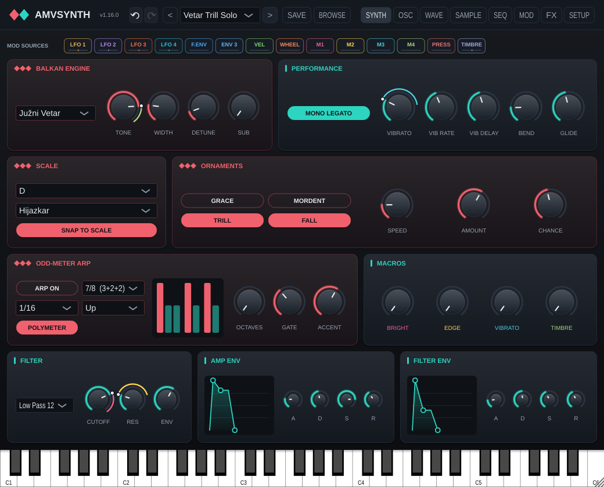
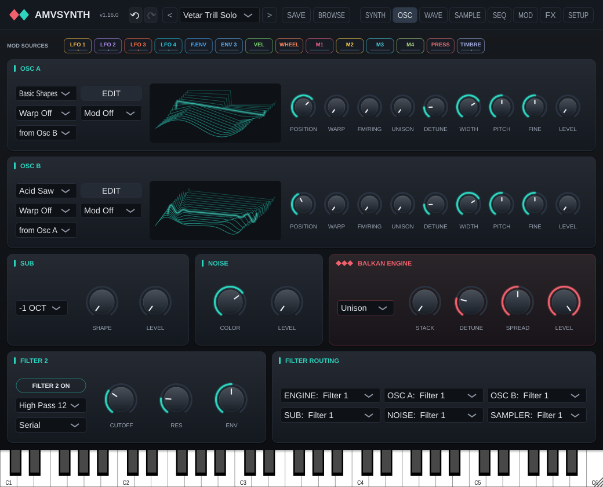
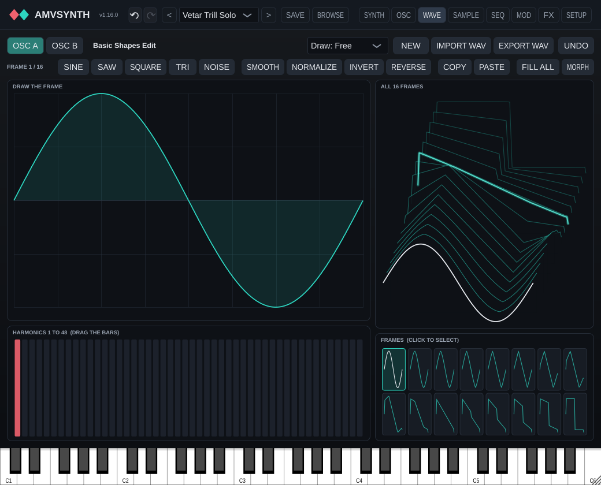
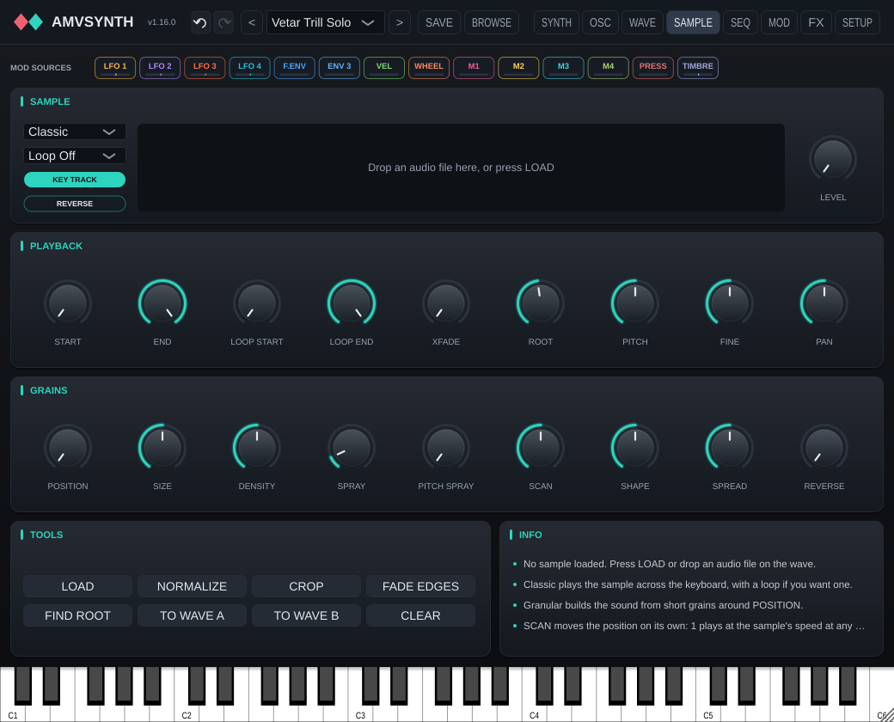
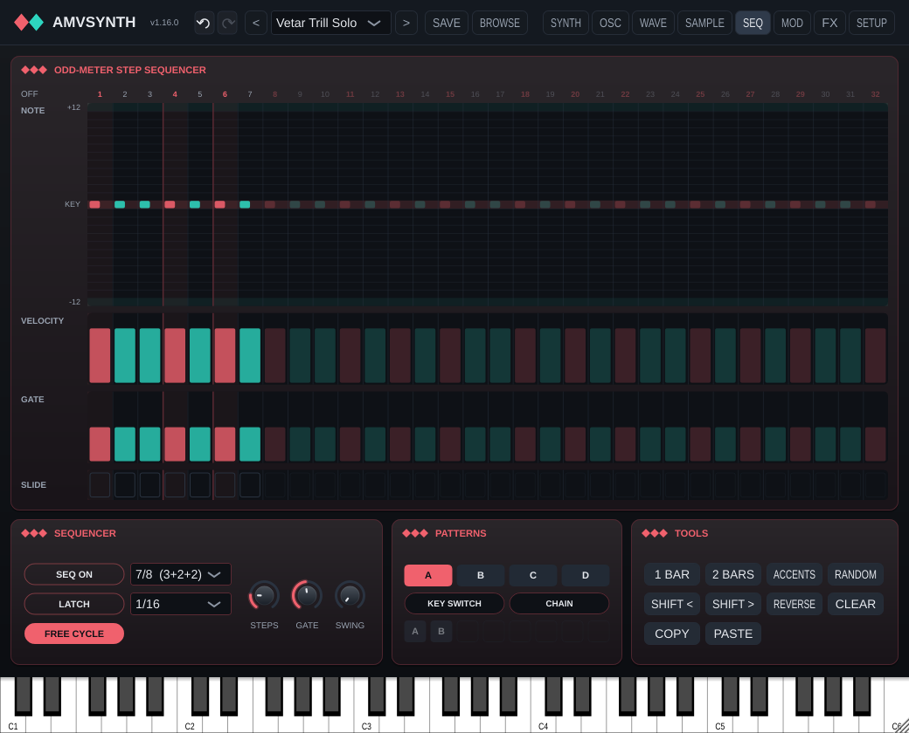
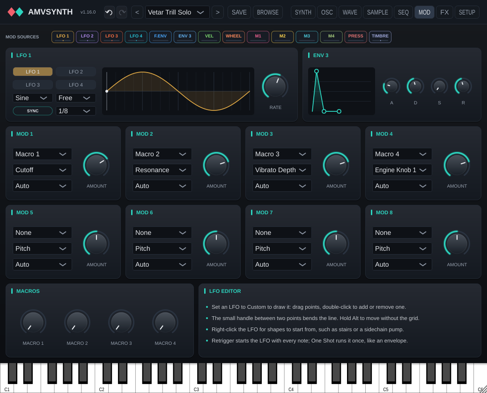
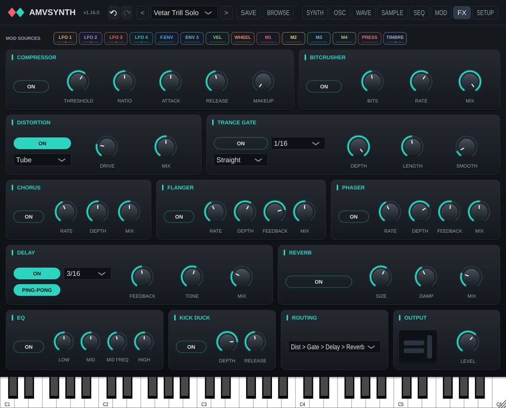
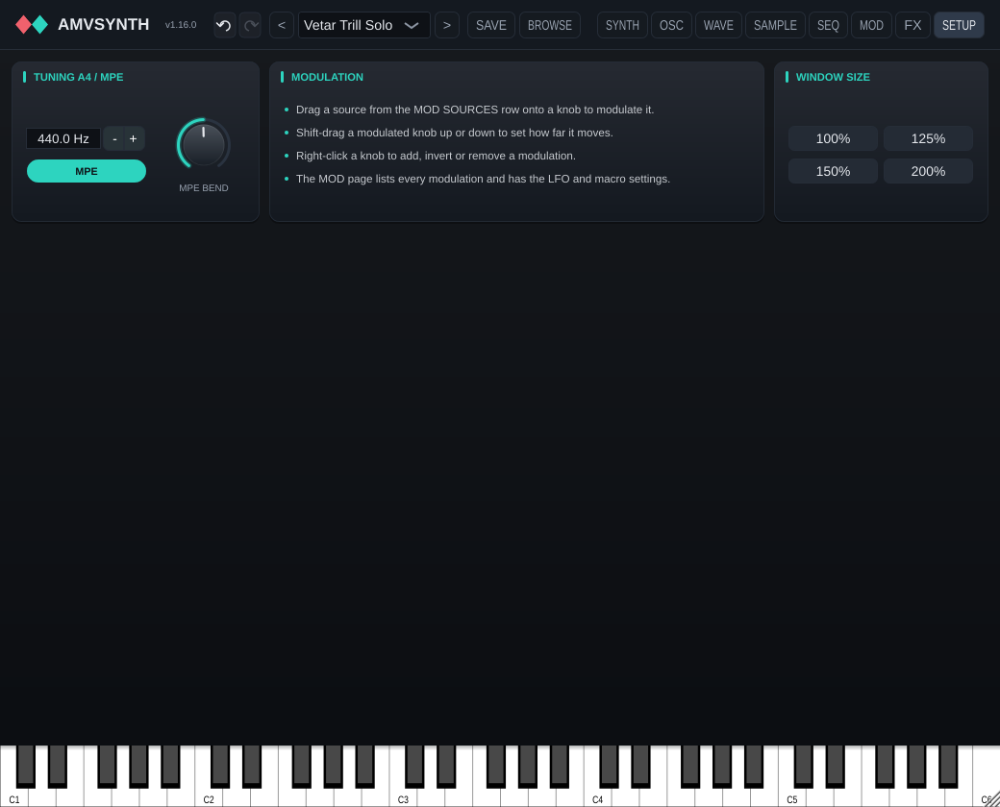
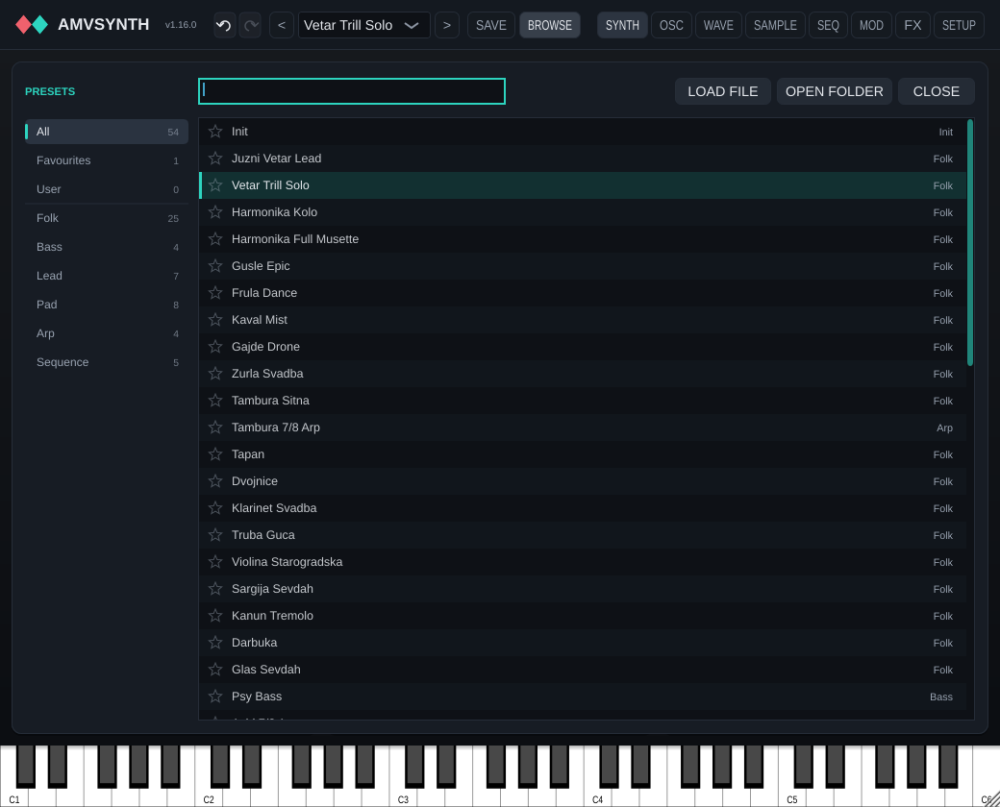

# AMVSynth manual

A short guide to every page of the plugin. It assumes AMVSynth is installed and loaded on an instrument track; the [README](../README.md) covers installing.

- [How the sound is made](#how-the-sound-is-made)
- [The header](#the-header)
- [SYNTH](#synth): the instrument, the scale, ornaments, arpeggiator, macros, filter and envelopes
- [OSC](#osc): wavetable oscillators, sub, noise, stacking the Balkan model, second filter
- [WAVE](#wave): the wavetable editor
- [SAMPLE](#sample): the sampler
- [SEQ](#seq): the step sequencer
- [MOD](#mod): LFOs, the third envelope and the modulation list
- [FX](#fx): the effects
- [SETUP](#setup): tuning, MPE and the size of the window
- [The preset browser](#the-preset-browser)
- [Recipes](#recipes)

## How the sound is made

Every note is built from up to six sources, which are mixed and then filtered:

1. the **Balkan engine**, one of seventeen modelled instruments (SYNTH page),
2. **oscillator A** and **oscillator B**, two wavetable oscillators (OSC page),
3. the **sub** oscillator and the **noise** (OSC page),
4. the **sampler** (SAMPLE page).

The mix runs through the **filter** (and the second filter, when it is on), is shaped by the **amp envelope**, and then all notes together run through the **effects** (FX page). A source with its LEVEL at zero is silent and costs nothing. A new sound starts with only the Balkan engine turned up.

Notes come from your keyboard or the host, and can pass through the **step sequencer** or the **arpeggiator** first. When the sequencer is on, the arpeggiator rests.

## The header

The header is the same on every page.

- **Undo and redo**: the two bent arrows left of the preset bar. They take back and bring back what you changed: a control, a preset, a pattern, a drawn wavetable or LFO shape, up to a hundred steps. Ctrl+Z (Cmd+Z on a Mac) and Ctrl+Shift+Z or Ctrl+Y do the same when the plugin window has the keyboard. Automation from the host is not counted as a step.
- **The preset bar**: `<` and `>` step through the factory presets, the box in the middle lists them all. **SAVE** writes the current sound as an `.amvpreset` file, with its wavetables, sample, patterns and LFO shapes. **BROWSE** opens the [preset browser](#the-preset-browser).
- **The tabs** on the right choose the page.
- **MOD SOURCES**, the coloured row under the header, is how you modulate: drag a source onto any knob. See [MOD](#mod).

Three things work on every knob:

- Double-click a knob to set it back to its default.
- Right-click a knob to add, invert or remove a modulation.
- Hover over anything for a short explanation.

## SYNTH

The main page: what plays, in which scale, and how it is shaped.

**BALKAN ENGINE.** Choose the model in the box. The four knobs next to it belong to the chosen model and change with it: the Južni Vetar lead has TONE, WIDTH, DETUNE and SUB, the gajde has DRONE, DRONE TUNE, BAG and EDGE, the tambura has PLUCK, DECAY, DOUBLE and TONE, and so on. Tapan and darbuka are drums: every key is a hit.

**PERFORMANCE.** MONO LEGATO plays one note at a time and slides between overlapping notes; turn it off for chords, up to 16 voices. VIBRATO, VIB RATE and VIB DELAY set a vibrato that comes in after the note starts, the way a player adds it. BEND is the range of the pitch wheel, GLIDE the time of the slide between notes.

**SCALE.** The root and the scale, with the quarter tones of the makam scales (Hijaz, Hijazkar, Nikriz, Rast, Ussak, Huseyni, Saba), and Pythagorean tuning. With SNAP TO SCALE every key plays a note of the scale, so you cannot play a wrong one. Without it the keys play as usual and only the tuning of the scale notes applies.

**ORNAMENTS.** GRACE, MORDENT, TRILL and FALL are played for you. CHANCE is how often a note gets one, SPEED how fast it is played, AMOUNT how deep the fall is. Turn CHANCE to the top for an ornament on every note, or keep it lower for a player who does not repeat himself.

**ODD-METER ARP.** ARP ON turns held chords into a pattern in 5/8, 7/8, 9/8, 11/8 or 4/4. The display shows the groups of the meter; the first step of each group is accented by ACCENT. POLYMETER lets the odd pattern cycle freely over the 4/4 bar of the host, which is what gives the rolling psytrance feel; without it the pattern restarts on every bar.

**MACROS.** Four knobs that each move several things at once. Every factory preset names and wires them: usually BRIGHT (or DARK, when the filter is already open), EDGE, VIBRATO and TIMBRE. Double-click a name to change it. To wire a macro yourself, drag M1 to M4 from the MOD SOURCES row onto a knob. Macros are the natural thing to automate in the host.

**FILTER, AMP ENV, FILTER ENV.** The filter has nine types, among them comb, formant and phaser; ENV is how far the filter envelope opens it. Each envelope can be set on the graph by dragging its points, or with the A, D, S and R knobs next to it.

## OSC

**OSC A and OSC B.** Each oscillator reads a wavetable: a row of single waves that POSITION moves through. The view shows all frames with the playing position marked.

- The first box chooses the table. **User** is your own table: **EDIT** opens it in the [wavetable editor](#wave), where you can also import one.
- **WARP** bends the wave before it is read (Bend +, Bend -, PWM, Sync, Mirror); the WARP knob sets how much.
- **FM/RING**: choose FM, ring or amplitude modulation in the second box of the lower row and the modulator in the box under it (the other oscillator, the sub, the noise, the Balkan engine or the sampler). The modulator works even when its own level is down.
- **UNISON**, **DETUNE** and **WIDTH** stack up to seven copies, detune them and spread them left and right.
- **PITCH** in semitones, **FINE** in cents, and **LEVEL**. Both oscillators start at level zero.

**SUB** is a sine or square one or two octaves down. **NOISE** has a COLOR from dark to bright.

**BALKAN ENGINE** on this page is the level of the model in the mix, and its **stack**: STACK is the number of copies of the model per note, up to five. In **Unison** they are detuned by DETUNE and spread left and right by SPREAD, which turns one zurla into a wall of them. The other modes tune the copies to **Octaves**, **Fifths**, or a **Minor**, **Major** or **Sus4** chord, so one key plays a chord. The drums are never stacked.

**FILTER 2** is a second filter, in series after the first or in parallel with it. **FILTER ROUTING** sends each source to filter 1 or filter 2, for example the bass oscillator through a low pass and the folk lead through a formant filter.

## WAVE

The editor for the User wavetable of oscillator A or B (the two buttons at the top left). A table has 16 frames; the strip at the bottom right selects one.

- **Draw the frame** with the mouse in the large area. The Draw box switches between a free line and a step grid.
- **Harmonics**: the 48 bars at the bottom left build the frame from its overtones. Drag them up and down.
- **SINE, SAW, SQUARE, TRI, NOISE** start the frame from a basic shape. **SMOOTH, NORMALIZE, INVERT, REVERSE** change it.
- **COPY** and **PASTE** move a frame, **FILL ALL** copies the frame to the whole table, and **MORPH** fills the frames between the first and the selected one with a gradual change, which is the quick way to a table that moves when POSITION is modulated.
- **NEW** starts a table, also as a copy of a built-in one. **IMPORT WAV** reads a file with a row of 2048-sample frames or a single cycle of any length; **EXPORT WAV** writes yours.

Every change is heard at once on the oscillator, as long as its table is set to User and its level is up.

## SAMPLE

A sampler for your own sounds, mixed with the other sources before the filter. Press **LOAD** or drop a WAV, AIFF, FLAC, MP3 or OGG file of up to 60 seconds on the display. The sample is saved inside the project.

**Classic** mode plays the sample across the keyboard. ROOT is the key at which it plays at its own pitch (FIND ROOT measures it), KEY TRACK off plays every key at the same pitch, which suits drum hits and speech. START and END are also dragged in the display, as are the loop markers; the loop runs forward or ping pong, with XFADE to hide the join.

**Granular** mode builds the sound from short grains around POSITION. SIZE and DENSITY set the grains, SPRAY and PITCH SPRAY scatter them, SPREAD places them left and right. **SCAN** moves the position on its own: at 1 the sample plays at its own speed, at 0 it stands still, below zero it runs backwards, and the pitch stays with the key. That freezes, stretches or reverses a vocal phrase at any pitch.

**TOOLS**: NORMALIZE, CROP to the start and end markers, FADE EDGES, and **TO WAVE A / TO WAVE B**, which cut single cycles from the sample into the User wavetable of an oscillator.

## SEQ

A step sequencer of up to 32 steps. Hold a key and the pattern plays from it; another key transposes it.

**The grid** has four lanes that share the columns, one column per step:

- **NOTE**: the pitch of the step, up to an octave above or below the held key.
- **VELOCITY** and **GATE**: how hard and how long. Drag across several steps to draw a shape.
- **SLIDE**: the step is held into the next one. In Mono Legato that is a glide, the acid slide; two steps with the same note become one long note.
- A **right click** on a step turns it into a rest and back.

The columns are grouped like the meter, and the step that is playing lights up.

**SEQUENCER.** SEQ ON, the meter (5/8, 7/8, 9/8, 11/8, 4/4), the step length and STEPS, the number of steps that play: any length from 1 to 32. GATE scales all gates, SWING delays every second step. LATCH keeps the pattern running after you let go of the key. FREE CYCLE lets an odd pattern roll over the 4/4 bar; without it the pattern restarts on every bar.

**PATTERNS.** A sound has four patterns, **A** to **D**. Click a letter to edit and play it. With **KEY SWITCH** the lowest keys, C0 to D#0, choose the pattern while you play and are not heard themselves. **CHAIN** plays up to eight patterns one after the other: click the small boxes under the buttons to set the order.

**TOOLS.** 1 BAR and 2 BARS set the length to the meter. ACCENTS writes the velocities from the groups of the meter. RANDOM writes notes from the chosen scale. SHIFT moves the pattern a step left or right, REVERSE turns it around, CLEAR empties it, COPY and PASTE carry a pattern from one letter to another.

## MOD

Modulation moves a knob for you. The quick way works on every page:

1. Drag a source from the **MOD SOURCES** row (an LFO, an envelope, velocity, the mod wheel, a macro, pressure or timbre) onto a knob.
2. Hold Shift and drag that knob up or down to set how far the source moves it. A coloured ring on the knob shows the range, and a dot shows where the value is now.
3. Right-click the knob to invert or remove the modulation.

The MOD page shows the same thing as a list, and has the settings of the sources.

**LFO 1 to 4.** Choose the LFO with the four buttons. Each has a shape, a RATE in hertz or, with SYNC, in note lengths of the host tempo, and a mode: Free runs on its own, Retrigger restarts with every note, One Shot runs once like an envelope. Set the shape to **Custom** to draw it: drag the points, double-click to add or remove one, drag the small handle between two points to bend the line. A right click offers shapes to start from, such as stairs or a sidechain pump.

**ENV 3** is a third envelope that does nothing on its own; it is there to be dragged onto something.

**MOD 1 to 8** are the eight modulations of the sound: the source, the destination, the polarity and the AMOUNT. Auto polarity lets LFOs swing both ways and everything else move one way.

**MACROS** are the same four knobs as on the SYNTH page.

## FX

Twelve effects, laid out in the order the sound runs through them. Each has its own ON switch.

- **COMPRESSOR** and **BITCRUSHER** come first.
- **DISTORTION**: tube, fold or crush.
- **TRANCE GATE** chops the sound in a pattern at the host tempo, with odd-meter patterns too. DEPTH is how far it closes, SMOOTH rounds the edges.
- **CHORUS**, **FLANGER**, **PHASER**.
- **DELAY**, synced to the tempo, with PING-PONG between left and right, and **REVERB**.
- **EQ** with three bands; MID FREQ moves the middle one.
- **KICK DUCK** lowers the sound on every beat, the way sidechain compression against a kick does, without needing the kick.
- **ROUTING** chooses the order of distortion, gate, delay and reverb. **OUTPUT** is the level of the plugin, with a meter; a limiter at the very end catches peaks.

Most MIX knobs, and several others, can be modulated like any knob: an LFO on the delay mix or a macro on the reverb size.

## SETUP

Settings that belong to the project and not to a sound. A preset does not change them.

- **TUNING A4**: the pitch of the A above middle C. Click the number and type a value, for example 432.
- **MPE** turns on per-note pitch bend, pressure and timbre for MPE controllers and for the note expressions of the host. MPE BEND is the per-note bend range.
- **WINDOW SIZE**: 100, 125, 150 or 200 percent. Everything scales, the text too. Dragging the corner of the window gives any size in between, and the size is remembered for the next time.

## The preset browser

BROWSE in the header opens the browser over the page.

- The list on the left filters by category: All, Favourites, User, and the factory categories Folk, Bass, Lead, Pad, Arp and Sequence.
- Type in the search box to filter by name.
- A click or the arrow keys load a preset straight away, so you can hold a note and play through the list. A double click or Return closes the browser.
- The star in front of a name marks a favourite.
- **User** presets are the `.amvpreset` files in the folder `AMVSynth Presets` in your Documents, with its subfolders. OPEN FOLDER shows it, LOAD FILE loads a preset from anywhere.

## Recipes

**A Južni Vetar lead in a makam.** Load *Juzni Vetar Lead*. On SYNTH choose the root of your track and Hijaz or Nikriz, and keep SNAP TO SCALE on. Play legato lines: overlapping notes slide, and the ornaments come on their own. Raise CHANCE for more of them.

**A rolling 7/8 bass line.** Load *Psy Bass*. On SEQ turn SEQ ON, choose 7/8 and press 1 BAR, then ACCENTS. Draw a few notes, add slides before the accents, and leave FREE CYCLE on so the seven steps roll over the 4/4 kick.

**Two patterns for verse and drop.** Draw pattern A, press COPY, click B, press PASTE and change it. Turn KEY SWITCH on and play C0 and C#0 in the host to switch between them, or turn CHAIN on and set the boxes to A A A B.

**A wall of zurle.** Choose Zurla on SYNTH. On OSC set STACK to 5 in Unison, DETUNE around 20 and SPREAD near the top.

**A chord stab from one key.** Choose Accordion, set the stack mode to Minor and STACK to 3, and shorten the amp envelope. Add the delay.

**A moving filter in time with the track.** Drag LFO 1 onto CUTOFF and shift-drag CUTOFF to set the depth. On MOD turn SYNC on for LFO 1 and choose 1/8, or set the shape to Custom and draw a pump.

**Your own voice as an instrument.** Load a recording on SAMPLE, switch to Granular, set SCAN to zero and move POSITION with a macro or an LFO. The pitch follows the keys while the position stays where you put it.
